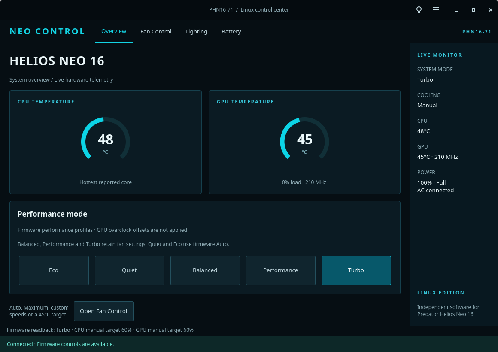

# Neo Control for Predator Helios Neo 16 PHN16-71

A native GTK4 Linux control panel and a small, model-specific firmware driver, built and tested on this laptop: Acer Predator PHN16-71, BIOS V1.20, Fedora 44, kernel 7.2.11-200.fc44.x86_64, NVIDIA RTX 4050 Laptop GPU. This is unofficial software, not an Acer release or a complete port of PredatorSense.



**Experimental: verified on one PHN16-71. Other models are deliberately rejected by the driver.**

**Installing on CachyOS? Start with the [CachyOS setup guide](README-CACHYOS.md).**

## Use

Open **Neo Control** from the application menu after installation. The native interface now has **Overview**, **Fan Control**, **Lighting**, and **Battery** tabs, live circular temperature/RPM gauges, and a persistent monitoring sidebar. Its black/cyan visual direction is based on the PHN16-71 manual’s PredatorSense screens; it remains independently branded. It offers:

- Automatic, maximum, a best-effort 45°C target, and separate CPU/GPU manual fan settings (30–100%). The percentages are firmware requests, not a percentage of maximum RPM. Actual RPM is displayed separately.
- Eco, Quiet, Balanced, Performance and Turbo firmware profiles. Quiet, Performance and Turbo require AC power. Balanced, Performance and Turbo preserve the selected Automatic/Maximum/manual fan setting. Quiet and Eco select Automatic. The driver briefly uses Auto during a profile transition, then the app restores the selected fan setting and verifies it. If restoration fails, it attempts Auto and reports the partial failure.
- Eight keyboard effects, effect speed, brightness, color and supported directions; separate colors for four zones.
- The firmware's 80% battery charge-limit switch and live battery status.
- CPU/GPU temperature, GPU activity and clock readings, plus copyable diagnostics.

### 45°C cooling target

In **Fan Control**, choose **45°C target**. This is a software-controlled fan mode; it does not rewrite Acer’s firmware Auto curve and cannot enforce a temperature ceiling. It samples CPU/GPU temperatures about every two seconds and uses the hotter reading for both fans:

| Hottest temperature | Fan request |
|---|---|
| Below 36°C | 40% |
| 36°C to below 39°C | 60% |
| 39°C to below 42°C | 80% |
| 42°C and higher | Maximum |

It starts at Maximum, raises speed immediately, and waits 15 seconds at a stable lower request before reducing speed. Missing, invalid, or stale sensor readings request Maximum. A failed control cycle attempts firmware Auto and displays an error. Only completed sensor/control cycles renew its lease; a stalled app therefore falls back through the existing driver watchdog. Closing the window keeps target cooling running in the background. Selecting another fan or performance mode stops the target.

The live short test reached roughly 7,750 CPU / 7,040 GPU RPM but remained above 45°C (CPU 50–57°C, GPU 48–50°C) in Turbo under the observed workload. Fan control alone did not achieve the requested temperature. This target is therefore best effort, not a guarantee. It does not reduce CPU/GPU power limits or clocks.

Use **Custom** to reveal the manual sliders, then **Apply manual speeds**. The **Auto** button always selects Acer’s own firmware curve. A normal launch starts without changing settings; `python3 neo_control.py --cool-target` explicitly starts target cooling. The target preference is not saved across normal launches.

The app does not apply saved settings on startup. **Closing the window hides it and keeps manual, maximum, or target cooling running in the background.** Press the PredatorSense button or launch Neo Control again to reopen the same window. To stop the controller, use the header menu’s **Quit and restore Auto** action. If it crashes or stops refreshing its heartbeat, the driver attempts Auto after 45 seconds (checked every five seconds), retrying on failure. Suspend preparation and module removal also restore Auto when the driver owns a fan override. Background operation lasts for the current login session; it does not persist manual settings through logout or reboot.

If the keyboard is dark, raise **Brightness** and press **Apply lighting effect** or **Apply four-zone colors**. Reading zero brightness does not mean RGB is unsupported.

On this model, static colors are stored in four separate zone registers. The Static effect's color picker writes all four; the four-zone section sets them independently. Animated speed and supported direction/color fields are checked against firmware readback after each change.

## Verified on this laptop, 21 October 2026

| Control | Observed result |
|---|---|
| Maximum fans | CPU 7,784 RPM; GPU 7,046 RPM |
| Independent manual fans | CPU 55%, GPU 65% read back exactly; about 5,073 / 4,900 RPM after eight seconds |
| Automatic recovery | Both fan modes changed back to Auto after deliberately withholding heartbeat |
| Profiles | All IDs 0, 1, 4, 5, 6 accepted and read back |
| CPU power limits | Firmware MMIO sustained limit: Quiet 45 W, Balanced 70 W, Performance 80 W, Turbo 100 W; Eco on AC read 70 W |
| Keyboard | All eight effect IDs and four distinct zone colors accepted and read back. User visually confirmed red, wave and red/green/blue/white zones |
| Battery limiter | Enabled/disabled values accepted and read back; original value restored. A complete charge-to-80% cycle has not been observed |

Measurements are short functional tests, not thermal/load benchmarks. Power limits are configured limits, not measured CPU consumption; both MSR and MMIO limits exist. See `evidence/hardware-test.json` and `evidence/extras-test.json` for recorded observations (local filesystem paths are redacted in this repository). Tests returned the laptop to its original Balanced profile, automatic fans, original lighting and charge-limit setting.

Follow-up verification: the user confirmed the fans became much louder during the maximum-speed test. The profile-retention update was tested with Maximum across Balanced/Performance/Turbo, manual 55%/65% into Balanced, and Automatic on Quiet/Eco. See `evidence/profile-fan-retention.json`.

## What is not implemented or verified

- Windows GPU core/memory overclock offsets. The supplied PHN16-71 configuration contains Turbo values 100/200; selecting firmware Turbo in this app does **not** apply those NVIDIA offsets.
- Windows game/scenario automation, MUX switching, LCD overdrive, USB charging, boot sound, battery calibration, per-key RGB and arbitrary CPU undervolting/overclocking.
- The PredatorSense launch button is now bound in this user’s GNOME keyboard shortcuts to open/focus Neo Control (`XF86Launch1`, observed scan code 0xf5 / KEY_PROG1). The user confirmed it works. This desktop preference persists across login/reboot and is separate from the installer and kernel driver. Manage/remove it in GNOME Settings → Keyboard → Custom Shortcuts → Neo Control — PredatorSense button. The separate performance/Turbo key is still not implemented. The old PredatorSense hotkey service remains disabled to avoid competing controllers.
- Resume/reboot behavior is implemented but has not been physically tested by suspending or rebooting this active session.
- This driver deliberately accepts only exact DMI model `Predator PHN16-71`. Other models need their own verification.

## Linux distribution compatibility

The GTK4 app and Acer WMI protocol are not Fedora-specific. The driver remains restricted to **Acer Predator PHN16-71** regardless of distribution.

| Distribution | Status |
|---|---|
| Fedora with systemd | Hardware-tested on the original laptop; dependency and installation helpers included |
| CachyOS with systemd | DKMS build and installation passed against real 7.2.7-1-cachyos Clang/ThinLTO headers in an Arch container; physical CachyOS boot/fan testing is pending |
| Arch Linux and Arch-based systems with systemd | Clean Arch container passed kernel build against 7.2.11-arch1-1, GTK lifecycle and software tests; physical hardware testing pending |
| Other Linux distributions | GUI/driver source may be portable, but automatic dependency/boot-image setup is not implemented |

KDE Plasma, GNOME and Xfce can run the GTK4 app. There is no GNOME dependency for fan control. The PredatorSense shortcut must be configured separately in the chosen desktop. The hardware driver cannot be replaced by a standalone Flatpak or AppImage.

## Install on CachyOS / Arch

Start with an up-to-date installation. If Git is missing, install it with `sudo pacman -Syu --needed git`. **Reboot after a kernel upgrade before continuing**, so the running kernel and installed headers can match.

```sh
git clone https://github.com/rafio1020/neo-control.git
cd neo-control
./install.sh --install-deps
```

The dependency step uses `pacman -Syu --needed`, including a full system upgrade. It reads `/lib/modules/$(uname -r)/pkgbase` to select the matching headers, such as `linux-cachyos-headers`, `linux-cachyos-lts-headers`, `linux-cachyos-bmq-headers`, or `linux-zen-headers`. It also installs DKMS, the GTK4/Python/Cairo runtime, and GCC/LLVM build tools. **If this step updates your kernel, reboot, return to this directory, and continue:**

```sh
./install.sh --check
./install.sh
```

Run the installer as your normal desktop user, not with `sudo ./install.sh`. It requests administrator authentication for the system step (sudo in a terminal, polkit otherwise), adds that user to `linuwu_sense`, and creates the desktop launcher. If an existing Acer driver is loaded, it leaves that driver running, installs Neo Control for the next boot, and asks you to reboot. Otherwise it starts Neo Control immediately; log out/in if your group membership is new. No fan settings are automatically selected on installation.

After reboot, open **Neo Control** in the application menu. Check the installation with:

```sh
systemctl status neo-control.service --no-pager
python3 /opt/neo-control/neo_control.py --diagnose
```

### Kernel and boot support

DKMS builds against the actual installed kernel headers. The Makefile reads the target kernel's `CONFIG_CC_IS_CLANG` setting and uses `LLVM=1` for Clang/LTO builds. Install headers for **every kernel you intend to boot**; DKMS can only rebuild for kernels with matching headers. The installer initially builds for the running kernel. Before booting another already-installed kernel, install its headers and run `sudo dkms autoinstall -k <kernel-release>` for that exact release; confirm it is listed as installed by `dkms status`. Custom kernels may need additional toolchain dependencies.

The installer blacklists competing Acer control modules and refreshes the boot images. On CachyOS/Arch it selects the available Limine wrapper, mkinitcpio, dracut, or booster using the same priority as CachyOS's `update-initramfs` helper. This also runs when uninstalling, to remove this project's blacklist from boot images. If boot-image generation fails, fix the reported error and rerun the installer before rebooting.

Secure Boot module signing/key enrollment is **not** configured automatically. If the service reports `Key was rejected by service` or `Required key not available`, configure DKMS signing and enroll the key using your distro's Secure Boot procedure. Check `journalctl -u neo-control.service -b` and the kernel log for the actual failure. Kernel lockdown was disabled during the original Fedora tests.

If a competing Acer driver still loads after reboot, check for an explicit entry in `/etc/modules-load.d/`, `/etc/mkinitcpio.conf` or another control application's service. A blacklist cannot override every explicit load request. The service refuses to load a second controller over an active one.

### PredatorSense button on your new desktop

Create a keyboard shortcut that runs `/usr/bin/python3 /opt/neo-control/neo_control.py`, then press your PredatorSense button to assign it. On this laptop it reports `XF86Launch1`. In GNOME use **Settings → Keyboard → Custom Shortcuts**; in KDE Plasma use **System Settings → Keyboard → Shortcuts** and add the Neo Control application or command. Desktop preferences from the Fedora installation do not transfer automatically to CachyOS.

### Fedora and existing installations

The same `./install.sh --install-deps`, `./install.sh --check`, and `./install.sh` commands work on Fedora. The dependency helper uses DNF with `kernel-devel` for the running kernel. For an update, first choose **Menu → Quit and restore Auto**, run `git pull --ff-only` in the checkout, then rerun the installer. The GUI must be restarted to pick up code changes.

To preview the dependency command without installing anything: `python3 setup_support.py --dependency-command`. Preflight (`./install.sh --check`) reads system information without changing firmware, packages, or boot settings.

Installed locations:

- `/opt/neo-control/`: app, license, instructions and test records.
- `/usr/src/neo-control-0.1.0/`: complete driver source and DKMS definition.
- `/etc/systemd/system/neo-control.service`: loads the driver and grants the existing `linuwu_sense` group access to six named controls.
- `/etc/modprobe.d/neo-control.conf`: prevents competing `acer_wmi`, `facer` and `linuwu_sense` modules from autoloading.
- `~/.local/share/applications/neo-control.desktop`: desktop launcher.

Existing Acer apps and their files are retained. The installer disables the old `predator-sense-boot-apply.service` and user `predator-sense-hotkey.service`; their enabled state is recorded for uninstall. Other pre-existing blacklists and Linuwu files remain unchanged. Do not run multiple Acer hardware-control apps together.

To build only: `make -C kernel`. To load only for the current boot: `pkexec /usr/bin/bash ./load-test-driver.sh`. Loading the module does not change settings. An already-loaded Neo Control module is reloaded by that test script, restoring owned fan overrides to Auto first.

To inspect without changing settings: `python3 neo_control.py --diagnose`.

To run software validation: `python3 -m unittest discover -s . -p 'test_*.py'`. Installer tests cover kernel variants, dependency selection, boot-manager selection, missing/mismatched headers and LLVM build selection, without installing packages or writing hardware settings.

The scripts `verify_hardware.py` and `verify_extras.py` actively change real hardware settings temporarily and restore their recorded initial profile/lighting/limit. They are development checks, not startup routines. The fan test intentionally ends in Auto.

## Remove

Choose **Menu → Quit and restore Auto**, then run `./uninstall.sh` as your normal user. It restores automatic fan control, removes the DKMS module/startup service and launcher, and re-enables the old services if previously enabled. Source, app files and evidence remain for inspection. It leaves all pre-existing Acer blacklists intact; restoring a different driver is a separate action.

## Protocol and reverse-engineering evidence

The supplied Windows package was inspected locally using [official REA](https://github.com/morluto/rea) 6.7.0 and Ghidra 12.1.4. Static analysis recovered the Windows mode IDs and the exact 16-byte keyboard packet. No Windows executable or extracted JavaScript was executed. See the accompanying `rea-findings.md` for evidence IDs, scope and limitations.

The driver uses documented/reverse-engineered Acer WMI encodings from [Linux acer-wmi](https://github.com/torvalds/linux/blob/master/drivers/platform/x86/acer-wmi.c), [Linuwu-Sense](https://github.com/0x7375646F/Linuwu-Sense) (revision `4483b6c38b9bb963ac9ada9ca476578e0c63cc08`) and [Predator Sense/facer](https://github.com/cleyton1986/predator-sense). The installed facer source SHA-256 was `6c1f66b2f5b565df9e18acf86322cc6146b58e359a28bf1dabd1b819ed410e0e`; its PHN16-71 quirk omitted modern profile/PWM feature flags. That was a concrete deficiency in the local setup, not proof that every Linux alternative is broken.

This implementation exposes bounded typed controls, checks firmware status and readback, and uses no raw EC memory writes, firmware flashing or arbitrary WMI command endpoint. An unavailable reading is represented as unavailable, not simulated success. Battery-limit support comes from the separate known firmware interface and live readback, not from a claimed complete reverse-engineering of the Windows battery implementation.

Source is provided under GPL-3.0-or-later; see LICENSE. Acer's proprietary binaries, application code and artwork are not included in this distribution.

## Interface verification

The redesign passed native GTK checks for all four navigation tabs and opening/closing Custom controls. All four pages were rendered and visually inspected. Twenty-five software tests cover protocol validation, profile fan retention, target thresholds, invalid/stale telemetry, and delayed slowdown. The real-hardware target test and updated screenshots are under `evidence/`. The kernel module was not changed for this redesign.

Visual reference: Acer PHN16-71 user manual, pages 46 and 54, [official PDF](https://global-download.acer.com/GDFiles/Document/User%20Manual/User%20Manual_Acer_2.0_A_A.pdf?BC=ACER&LC=en&OS=ALL&SC=AAP_5&Step1=&Step2=&Step3=PREDATOR+PHN16-71&acerid=638707085482391210).

### Background cooling verification

`dbus-run-session -- python3 test_lifecycle.py` checks native GTK window hiding, retained fan ownership and target controller, heartbeat while hidden, reopening the same window, and explicit Quit restoring Auto. Hardware writes are mocked in this lifecycle check.

The background-close change passed the mocked GTK lifecycle check. An uninterrupted hidden-window hardware test beyond the 45-second watchdog timeout has not yet been completed.

### Distribution integration references

- [CachyOS kernel packaging](https://github.com/CachyOS/linux-cachyos/blob/master/linux-cachyos/PKGBUILD): kernel `pkgbase` and per-kernel headers.
- [CachyOS boot-image helper](https://github.com/CachyOS/cachyos-hooks/blob/master/update-initramfs): boot-manager-specific regeneration order.
- [Arch DKMS packaging guidance](https://wiki.archlinux.org/title/DKMS_package_guidelines): per-kernel headers and pacman DKMS hooks.
- [Arch PyGObject](https://archlinux.org/packages/extra/x86_64/python-gobject/) and [Cairo bindings](https://archlinux.org/packages/extra/x86_64/python-cairo/): native GUI packages.

### Distribution checks, 23 October 2026

All 36 software tests passed on Fedora and in a clean Arch container. The driver built against Fedora 7.2.11 and Arch 7.2.11 kernel headers. In the container, DKMS built and installed the driver for the official CachyOS `7.2.7-1-cachyos` headers, selecting LLVM for the kernel's Clang/ThinLTO configuration. GTK4/Cairo imports, the complete window-close/reopen/quit lifecycle under Xvfb, and systemd unit validation passed. The CachyOS build warned that the container's Clang 23 differed from the kernel's Clang 22; compilation and DKMS installation still succeeded.

These are build and isolated GUI tests, **not a booted CachyOS hardware test**. No test module was loaded into the host kernel, and firmware writes were mocked in GUI tests. Boot-image regeneration, Secure Boot enrollment and real fans/RGB on CachyOS still need verification on the laptop after installing that OS. See `evidence/distro-compatibility.json` for versions and test scope.
